  

  

## About

Backend and systems engineer focused on building fast, reliable software. I work with **Go**, **Python** and **TypeScript** on Linux, caring about clean architecture, performance and developer experience — from APIs and services to the tooling around them.

  

## Stats

  
  

  
  

  

  

## Skills

  
  
  

  
  
  
  
  
  
  
  
  

  

## Connect

  
  
  
  
  

  

Always open to collaboration — let’s build something great.

